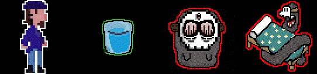
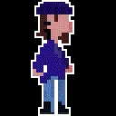
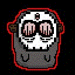
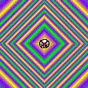
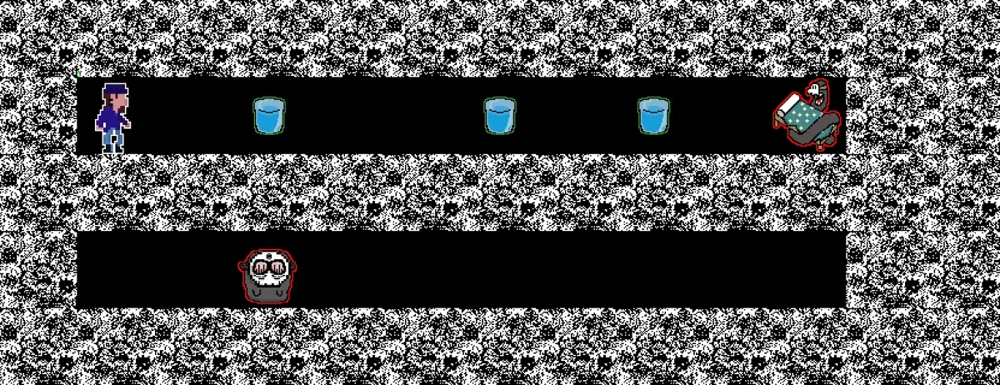
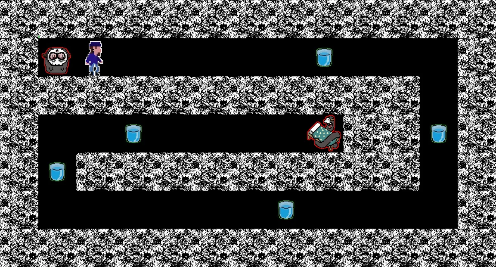
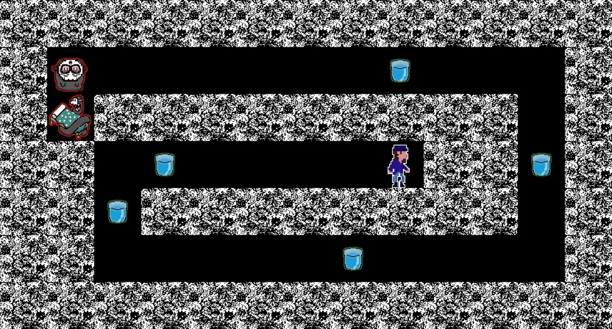

# Get2Bed

A small 2D game in C with the 42 MiniLibX, my so_long project at 42 Roma Luiss.

You're coming home after a night out and you've had a bit too much. To go to bed in peace you first have to drink all the water in the house, while the paranoias wander around trying to get you. As long as there's water left, a paranoia is waiting for you in bed too.



| | | |
|:---:|:---:|:---:|
|  |  |  |
| you | a paranoia: it moves and flickers | the walls when you've drunk everything |

All the pixel art is mine. When the last glass is gone the walls turn into a psychedelic swirl and the bed is free. If a paranoia catches you, the walls go red.



| | |
|---|---|
|  |  |

## What's inside

- maps read from `.ber` files, with checks for walls, items and a reachable exit
- animated sprites for the player, the water, the paranoias and the walls
- paranoias that move around the map
- the move counter on screen

## Run it

On Linux, with the X11 libraries installed (Debian/Ubuntu: `sudo apt install libx11-dev libxext-dev`):

```bash
make
./so_long maps/1_tutorial.ber
```

There are four maps: `1_tutorial`, `2_run`, `3_fight` and `final`. Move with W A S D, quit with Esc.
